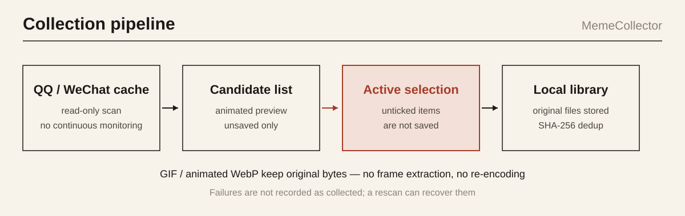
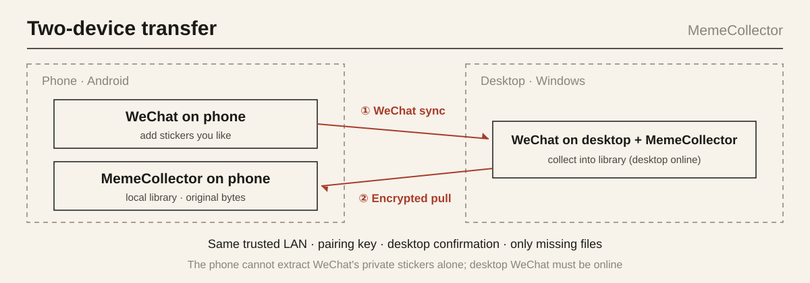


Status: maintained · Role: customized from OhMyMeme (solo developer) · Code: [public](https://github.com/coderirse/meme_sctaping) · Updated: 2026-11


## First, the honest part: this is a fork

MemeCollector is not something I wrote from scratch. It is based on [OhMyMeme](https://github.com/OhMyMeme/OhMyMeme)[2] (desktop, Python + Vue + pywebview) and [OhMyMeme-Android](https://github.com/OhMyMeme/OhMyMeme-Android)[3] (Kotlin). Both upstreams are GPL-3.0, I distribute under GPL-3.0, and the original attribution and licenses ship with the source. The upstreams are pinned to two commits (see `upstream-lock.json` in the repo), not chasing the latest branch.

What upstream already had: the overall framework, cloud sync, the plugin system, the GIF steganography stack, and QQ favorite extraction (integrated from [QQFavoriteExtract](https://github.com/VanillaNahida/QQFavoriteExtract)[5]). What I added:

- **Windows**: candidate selection, lazy download (fetch the original only on preview or save), an incremental index, strict format validation, failure cleanup
- **Android**: filtering and animated preview, result categories (success / duplicate / unsupported / over-limit / failed), permission guidance, bounded reads, an independent package name and signature
- **Both**: local-by-default, no auto-install of upstream updates; build scripts and tests
- And the security audit below, with 10 fixes

I put this boundary up front because every "I did" later in this post refers only to the list above, not to things upstream already had.

## What I wanted to solve

You see a sticker you like in QQ or WeChat and want to keep it. What you usually get: an animated sticker saved as a still, a screenshot that lost the animation, or nothing saved at all. I wanted the **original file** — a GIF stays that GIF, an animated WebP stays that animated WebP, no frame extraction, no re-encoding.

There is also a privacy trade-off: the tool **saves only what you actively select**. It stores what you tick, and does not continuously read all your chats. On WeChat it even requires you to open the sticker panel on desktop first, before it reads the manifest.

*Fig. 1: The collection pipeline — read-only scan, active selection, original bytes stored; GIF / animated WebP are not re-encoded. Source: author's own (CC BY-NC-SA 4.0) [1].*

## The byte-for-byte thing

Sounds simple. It is full of traps.

**Detect by content, do not trust the extension.** Cache files often have the wrong extension. On a vivo X100 Ultra (Android 16) I tested a file originally named `.jpg` that, by content, was actually a 240×240, 28-frame GIF; after saving, the bytes and SHA-256 matched exactly. Had I trusted the extension, that animation would have been treated as a still.

**Unsupported means unsupported.** WeChat store proprietary formats, QQ super stickers, files that will not decode — these are reported as "unsupported", not saved as a first frame pretending to succeed. I think this matters more than supporting a few extra formats: a fake success is worse than a failure.

**Dedup and incremental.** SHA-256 dedup; a failure is not recorded as "collected", so a rescan can recover it; one file failing does not affect the others. After saving that one GIF in testing, the unsaved candidates went from 755 to 754.

The default import limit is 20 MiB and 2560px on the longest side (Android keeps this limit to control memory; desktop can adjust it). Thumbnails and originals are stored separately.

## Where the WeChat key comes from

WeChat's sticker library is an encrypted SQLite database. The key is not in the file — it is in the WeChat process's memory. So the desktop side ships a small C++ helper that does process-memory forensics (read-only, no network, never writes anything to WeChat).

The main path for getting the key is **mask recovery**: the first 16 bytes of the library file are a known salt, and memory holds a 99-byte key buffer masked by a 32-byte XOR mask; the salt lets you recover the mask. The benefit is that it **does not depend on an RVA offset**, so a WeChat version change does not require finding a new offset (the old RVA scan is kept as a fallback). I implemented the SHA-512 primitives in-tree rather than pulling in OpenSSL.

A few details I care about:

- The helper's SHA-256 is pinned **at build time** — MSVC builds are not reproducible (they embed timestamps), so the script compiles it, hashes the actual artifact, writes that back into the source, then packages, instead of hand-committing a hash. Verification fails closed: with no real hash configured, it refuses to run.
- The test-only `--key` argument (inject a key directly, skipping forensics) is **compiled out entirely** in release; it exists only when a CMake option is explicitly enabled.
- The key is never written into the collection index and never sent to any cloud service. The Python side enforces a 90-second timeout.

(This describes the design, not a step-by-step how-to — it is for backing up my own stickers, not a tutorial.)

## The Android side: Shizuku and batch stat

Reading the phone's QQ cache directly on Android relies on [Shizuku](https://shizuku.rikka.app/zh-hans/guide/setup/)[4], not root. Two concrete traps:

- **Spawning a shell per file is too slow.** After switching to batch stat, ADB measured reading size/mtime/path for 756 files at about 0.22 seconds; the final signed APK took about 3 seconds from launch to listing 754 unsaved candidates.
- **Remote-process wait compatibility.** Polling a Shizuku remote process with Java's default timeout triggers `process hasn't exited`; I added a regression case to keep it from coming back.

It works without Shizuku too: file/album import, receiving system image shares, collecting on desktop and transferring back to the phone, and desktop ADB pull are all entry points that do not depend on Shizuku on the phone. Shizuku is a hard dependency only for the "read the QQ cache directly" path, not a prerequisite for the whole app.

*Fig. 2: Two-device transfer for WeChat stickers — add on the phone, collect on desktop, pull back over an encrypted LAN; only missing files move, original bytes preserved. Source: author's own (CC BY-NC-SA 4.0) [1].*

## Auditing my own fork

This is the part I think is most worth writing. A fork inherits upstream's code, and upstream's assumptions. To release it, to let other people use it, I have to go through those assumptions myself. I audited the main data paths (QQ/Shizuku, import and original-file saving, storage migration, backup recovery, cloud sync, the two-end LAN) and found 4 P1s and 6 P2s. A few:

- **After rejecting a device, the LAN data interface stayed open.** The device-confirmation code called `confirmed.set()` whether the user approved, rejected, or timed out; later requests checked only that event, not `approved`. The official Android client disconnects on rejection, but another client could keep pulling data. Fixed so that only explicit approval grants authorization; rejection/timeout disconnects immediately.
- **An empty key meant an all-zero AES key, and replayed frames were accepted.** An empty password derived to 32 zero bytes — anyone on the same subnet could decrypt; even with a password set, the session key was derived only from the password and a fixed salt, not bound to this handshake's nonces, and frames had no sequence number — I sent the same encrypted frame twice and both were accepted. LAN v2 now requires a non-empty key, derives directional keys from both sides' nonces, and uses authenticated sequence numbers, rejecting duplicate/out-of-order frames.
- **Backup recovery deleted before writing, with no rollback.** Originally, as long as the ZIP had a member named `memes.db` it would overwrite the existing library: delete all targets first, then copy one by one, and a mid-way failure left you with nothing. Changed to validate the backup format / database integrity / referenced media first, write fully to the new location with a rollback-capable commit, and keep the old data untouched until success.
- **Cloud manifest path traversal.** Batch pull handed the manifest's filename straight to `createFile`, so something like `../memes.db` could write outside the cache. Added a constraint at both the manifest entry and the file-write layer.

All 10 are fixed. After the fixes: desktop pytest 552 passed, 1 skipped; Android JVM 84 all passing; emulator import and recovery-safety 10 all passing; an independent two-end LAN animation round-trip 1 passing.

But the verification record draws a hard line: **an emulator is not a real device, and USB TCP forwarding is not Wi-Fi discovery.** Real Shizuku start/stop, vendor SAF failure behavior, and real Wi-Fi UDP auto-discovery and firewall behavior are all still untested on real hardware. And these 10 fixes currently live on the `codex/audit-hardening` branch — **no installer has been released yet**. v0.1.0 is the released version; the audit fixes are a next-release matter.

## Limits

- Android 11 on real hardware, Wi-Fi auto-discovery, firewall environments, and the full round-trip of a newly added WeChat sticker on the phone going to desktop and back are all still untested
- WeChat store proprietary stickers and QQ super stickers are unsupported, with no promise for future client versions
- WeChat key extraction depends on a specific client's memory layout; a major WeChat update may break it
- The maintenance cost of a fork is real: upstream updates have to be re-merged, not overwritten
- Personal use only; please follow QQ/WeChat and your platform's rules

## References

[1] lizhichao. MemeCollector[CP/OL]. GitHub, 2026. <https://github.com/coderirse/meme_sctaping>. GPL-3.0.
[2] OhMyMeme. OhMyMeme (desktop)[CP/OL]. GitHub, 2026. <https://github.com/OhMyMeme/OhMyMeme>. GPL-3.0.
[3] OhMyMeme. OhMyMeme-Android[CP/OL]. GitHub, 2026. <https://github.com/OhMyMeme/OhMyMeme-Android>. GPL-3.0.
[4] RikkaApps. Shizuku[CP/OL]. GitHub, 2026. <https://github.com/RikkaApps/Shizuku>. Apache-2.0.
[5] VanillaNahida. QQFavoriteExtract[CP/OL]. GitHub, 2026. <https://github.com/VanillaNahida/QQFavoriteExtract>. GPL-3.0.

